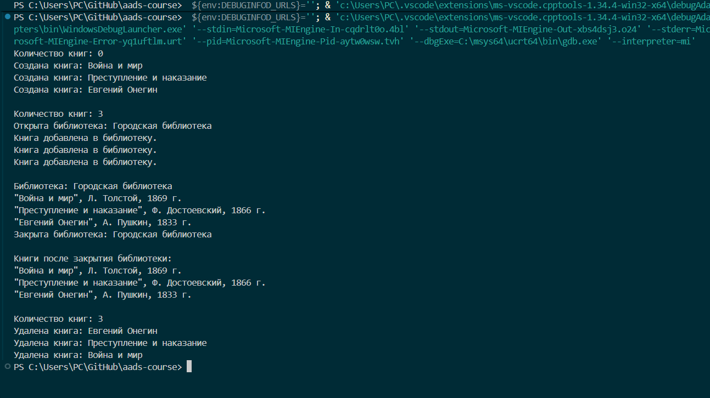

<div align="center">

МИНИСТЕРСТВО НАУКИ И ВЫСШЕГО ОБРАЗОВАНИЯ  
РОССИЙСКОЙ ФЕДЕРАЦИИ

Федеральное государственное автономное образовательное учреждение  
высшего образования

**«СЕВЕРО-КАВКАЗСКИЙ ФЕДЕРАЛЬНЫЙ УНИВЕРСИТЕТ»**

Институт информационных технологий и кибербезопасности  
Кафедра программной инженерии

<br><br><br>

**Отчёт к лабораторной работе № 1**

**Вариант 1**

**Тема:** «Композиция и агрегация классов. Статические члены»

**Дисциплина:** «Алгоритмы и структуры данных»

</div>

<br><br>

<div align="right">

**Выполнил:**  
Студент группы ПИЖ-б-о-25-1(1),  
направление подготовки: 09.03.04  
«Программная инженерия»  
Абдуллоев Орифжон Олимович

<br>

**Проверила:**  
ассистент кафедры программной инженерии  
Белик Ангелина Игоревна

</div>

<br><br><br>

<div align="center">

Ставрополь  
2026

</div>

---

## Цель работы

Изучить реализацию агрегации классов в C++, освоить использование статических полей и методов для подсчёта объектов и проверить, что объекты класса `Book` могут существовать независимо от объекта класса `Library`.

## Теоретическая часть

**Агрегация** — отношение между объектами, при котором один объект хранит ссылки или указатели на другие объекты, но не управляет временем их жизни. Например, библиотека может содержать сведения о книгах, которые существуют независимо от неё.

**Композиция** — отношение «часть–целое», при котором время жизни части зависит от времени жизни целого. При уничтожении целого его составные части также уничтожаются.

**Статическое поле** принадлежит классу в целом и является общим для всех его объектов. **Статический метод** можно вызвать без создания экземпляра класса; в частности, он может возвращать значение статического поля.

## Постановка задачи

В соответствии с вариантом 1 среднего уровня требуется реализовать классы `Library` и `Book`, связанные отношением агрегации. Класс `Book` должен содержать название книги, автора и год издания. Необходимо добавить статическое поле для подсчёта количества объектов `Book` и продемонстрировать, что книги продолжают существовать после уничтожения объекта `Library`.

**Ссылка на Git-репозиторий:** 


## Листинг программы

Полный исходный код приведён в отдельном файле `main.cpp`.
```cpp
class Book {
private:
    string title;
    string author;
    int year;

    static int bookCount; // Количество существующих объектов Book

public:
    Book(const string& title, const string& author, int year)
        : title(title), author(author), year(year) {
        ++bookCount;
        cout << "Создана книга: " << this->title << '\n';
    }

    ~Book() {
        --bookCount;
        cout << "Удалена книга: " << title << '\n';
    }

    void print() const {
        cout << '"' << title << "\", " << author
             << ", " << year << " г.\n";
    }

    static int getBookCount() {
        return bookCount;
    }
};
int Book::bookCount = 0;
```
Листинг 1 — Реализация класса Book и статических членов

```cpp
class Library {
private:
    string name;
    vector<Book*> books; // Агрегация: библиотека хранит указатели на книги

public:
    explicit Library(const string& name) : name(name) {
        cout << "Открыта библиотека: " << this->name << '\n';
    }

    ~Library() {
        // Книги не удаляются: библиотека не владеет их временем жизни
        cout << "Закрыта библиотека: " << name << '\n';
    }

    void addBook(Book* book) {
        if (book == nullptr) {
            cout << "Ошибка: передан пустой указатель.\n";
            return;
        }

        books.push_back(book);
        cout << "Книга добавлена в библиотеку.\n";
    }

    void print() const {
        cout << "\nБиблиотека: " << name << '\n';
        for (const Book* book : books) {
            if (book != nullptr) {
                book->print();
            }
        }
    }
};
```
Листинг 2 — Реализация класса Library и агрегации

```cpp
int main() {
    setlocale(LC_ALL, "");

    cout << "Количество книг: " << Book::getBookCount() << '\n';

    Book book1("Война и мир", "Л. Толстой", 1869);
    Book book2("Преступление и наказание", "Ф. Достоевский", 1866);
    Book book3("Евгений Онегин", "А. Пушкин", 1833);

    cout << "\nКоличество книг: " << Book::getBookCount() << '\n';

    {
        Library library("Городская библиотека");
        library.addBook(&book1);
        library.addBook(&book2);
        library.addBook(&book3);
        library.print();
    } // Библиотека уничтожается, книги продолжают существовать

    cout << "\nКниги после закрытия библиотеки:\n";
    book1.print();
    book2.print();
    book3.print();

    cout << "\nКоличество книг: " << Book::getBookCount() << '\n';
    return 0;
}
```
Листинг 3 — Главная функция main() и проверка работы программы

## Результаты работы

После запуска программы отображается начальное количество книг, создание трёх объектов `Book`, добавление книг в библиотеку и вывод их данных. После закрытия библиотеки сведения о книгах по-прежнему доступны, а счётчик остаётся равным трём. При завершении программы книги уничтожаются, и счётчик уменьшается.




## Ответы на контрольные вопросы

**Что такое композиция? Приведите пример.**

Композиция — отношение, при котором часть зависит от целого и обычно уничтожается вместе с ним. Пример: комнаты, входящие в состав дома.

**Что такое агрегация? Чем она отличается от композиции?**

Агрегация связывает объекты, которые могут существовать независимо друг от друга. В композиции время жизни частей зависит от целого.

**Как реализовать композицию в C++? Приведите пример кода.**

Композицию можно реализовать полем-объектом внутри класса: `class House { Room room; };`. Объект `Room` является частью `House`.

**Как реализовать агрегацию в C++? Приведите пример кода.**

Агрегацию можно реализовать указателем или ссылкой на существующий объект, например хранить в `Library` указатель `Book*`. При этом библиотека не должна удалять книгу.

**В чём разница между временем жизни частей при композиции и агрегации?**

При композиции часть обычно создаётся и уничтожается вместе с целым. При агрегации связанный объект может жить дольше целого.

**Что такое статическое поле класса? Чем оно отличается от обычного поля?**

Статическое поле общее для всего класса. Обычное поле принадлежит отдельному экземпляру, поэтому у разных объектов могут быть разные значения.

**Как объявить и определить статическое поле? Где оно хранится?**

Поле объявляют с ключевым словом `static` внутри класса, а в классическом варианте C++ определяют вне него, например: `int Book::bookCount = 0;`. Оно имеет статическое время хранения.

**Что такое статический метод? Можно ли из него обратиться к нестатическим полям?**

Статический метод принадлежит классу и вызывается без объекта. Напрямую обратиться к нестатическому полю он не может, поскольку не имеет указателя `this`.

**Для чего используются статические счётчики объектов?**

Они позволяют отслеживать количество существующих объектов. В этой программе счётчик увеличивается при создании книги и уменьшается при её уничтожении.

**Что такое паттерн «Одиночка» (Singleton)? Для чего он нужен?**

Singleton — шаблон проектирования, обеспечивающий наличие единственного экземпляра класса и общий способ доступа к нему.

**Как запретить создание копий объекта?**

Можно удалить конструктор копирования и оператор копирующего присваивания с помощью `= delete`.

**В каком порядке вызываются конструкторы и деструкторы при композиции?**

Сначала создаются составные части, затем целый объект. При уничтожении порядок обратный: сначала уничтожается целое, затем его части.

**Можно ли изменить статическое поле из обычного метода?**

Да. Обычный метод может изменять статическое поле класса.

**Почему статические поля нужно определять вне класса?**

В классическом варианте отдельное определение статического поля выделяет для него хранилище. В современных стандартах есть исключения, например `inline static`.

**В каких случаях стоит использовать композицию, а в каких — агрегацию?**

Композицию используют, если часть принадлежит целому и зависит от него. Агрегацию — если объекты связаны, но должны сохранять независимый жизненный цикл.

## Вывод

В ходе лабораторной работы были изучены агрегация классов, указатели и статические члены C++. Реализованы классы `Library` и `Book`, а также счётчик существующих книг. Проверено, что книги сохраняются после уничтожения библиотеки и удаляются при завершении программы.
