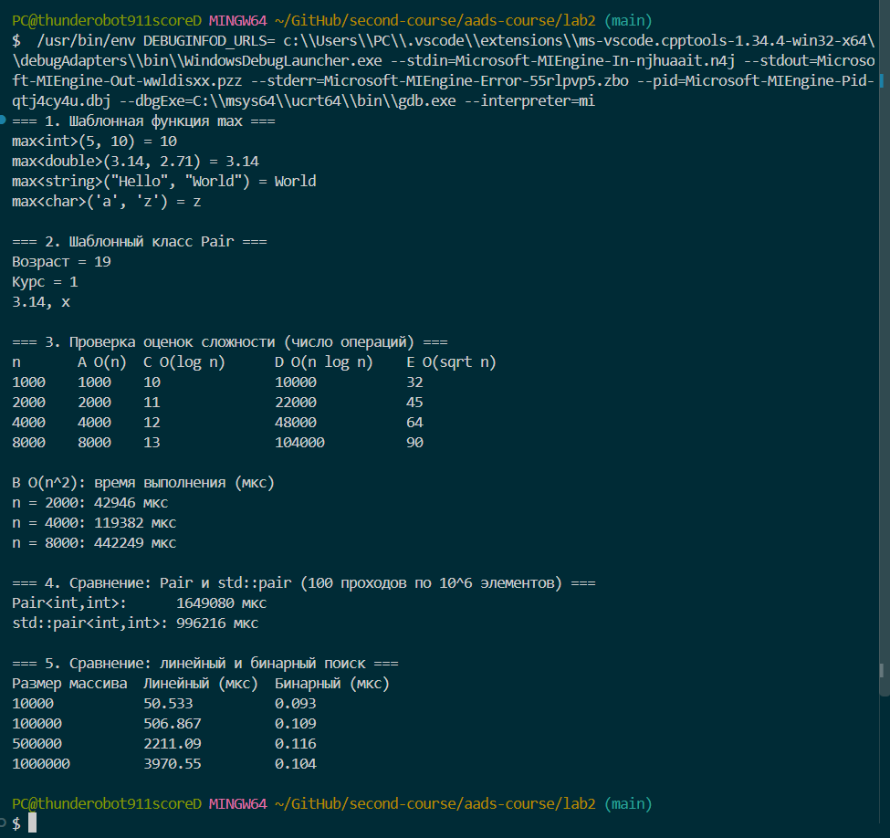

<div align="center">

МИНИСТЕРСТВО НАУКИ И ВЫСШЕГО ОБРАЗОВАНИЯ  
РОССИЙСКОЙ ФЕДЕРАЦИИ

Федеральное государственное автономное образовательное учреждение  
высшего образования

**«СЕВЕРО-КАВКАЗСКИЙ ФЕДЕРАЛЬНЫЙ УНИВЕРСИТЕТ»**

Институт информационных технологий и кибербезопасности  
Кафедра программной инженерии

<br><br><br>

**Отчёт к лабораторной работе № 2**

**Вариант 1**

**Тема:** «Анализ сложности алгоритмов. Шаблоны классов»

**Дисциплина:** «Алгоритмы и структуры данных»

</div>

<br><br>

<div align="right">

**Выполнил:**  
Студент группы ПИЖ-б-о-25-1(1),  
направление подготовки: 09.03.04  
«Программная инженерия»  
Абдуллоев Орифжон Олимович

<br>

**Проверила:**  
ассистент кафедры программной инженерии  
Белик Ангелина Игоревна

</div>

<br><br><br>

<div align="center">

Ставрополь  
2026

</div>

---

## Цель работы

Научиться оценивать эффективность алгоритмов с помощью O-нотации, определять класс сложности по тексту программы и подтверждать оценку экспериментом. Освоить создание шаблонов функций и классов на примере функции `max` и класса `Pair<T1, T2>`, а также сравнить производительность собственной реализации с аналогом из стандартной библиотеки.

## Теоретическая часть

**Анализ сложности** — способ оценить эффективность алгоритма в зависимости от размера входных данных `n`. Различают *временную* сложность, сколько операций выполняется и *пространственную* сложность, сколько памяти требуется.

**O-нотация (Big O)** описывает асимптотическое поведение функции при росте аргумента. Запись `f(n) = O(g(n))` означает, что существуют константы `c > 0` и `n₀` такие, что `0 ≤ f(n) ≤ c·g(n)` для всех `n ≥ n₀`. При записи отбрасывают константы и младшие слагаемые: `2n² + 100n + 1000` → `O(n²)`.

**Основные классы сложности:**

| Сложность | Название | Пример |
|---|---|---|
| O(1) | Константная | Доступ к элементу массива по индексу |
| O(log n) | Логарифмическая | Бинарный поиск |
| O(n) | Линейная | Линейный поиск, сумма элементов |
| O(n log n) | Линейно-логарифмическая | Быстрая сортировка, сортировка слиянием |
| O(n²) | Квадратичная | Пузырьковая сортировка |
| O(2ⁿ) | Экспоненциальная | Рекурсивное вычисление чисел Фибоначчи |
| O(n!) | Факториальная | Генерация всех перестановок |

**Шаблоны функций** позволяют написать функцию один раз и использовать её с разными типами данных: компилятор сам создаёт нужную версию (`max<int>`, `max<double>` и т. д.). **Шаблоны классов** работают аналогично, но для классов: тип (или несколько типов) указывается при создании объекта, например `Pair<string, int>`.

**Экспериментальный анализ** заключается в измерении времени работы алгоритма на входных данных разного размера (с помощью `std::chrono`) и сравнении того, как время растёт с увеличением `n`. Короткие операции измеряют многократным повторением, чтобы уменьшить влияние погрешности таймера.

## Постановка задачи

В соответствии с вариантом 1 среднего уровня требуется:

1. определить сложность фрагментов кода и обосновать ответ;
2. реализовать шаблонную функцию `T max(T a, T b)`, возвращающую максимальное из двух значений, и продемонстрировать её работу с разными типами данных;
3. реализовать шаблонный класс `Pair<T1, T2>` с операциями: конструктор, `getFirst`, `getSecond`, `setFirst`, `setSecond`;
4. указать сложность каждой операции класса;
5. провести экспериментальное сравнение двух реализаций.

**Ссылка на Git-репозиторий: ** 

## Листинг программы

Полный исходный код приведён в отдельном файле `main.cpp`.

```cpp
namespace lab {
template <typename T>
T max(T a, T b) {
    return (a > b) ? a : b; 
}
}
```
Листинг 1 — Шаблонная функция max

```cpp
template <typename T1, typename T2>
class Pair {
private:
    T1 first;
    T2 second;

public:
    Pair(const T1& f, const T2& s) : first(f), second(s) {}  
    T1 getFirst() const { return first; }                      
    T2 getSecond() const { return second; }                    
    void setFirst(const T1& f) { first = f; }                  
    void setSecond(const T2& s) { second = s; }                
};
```
Листинг 2 — Шаблонный класс Pair<T1, T2>

```cpp
int exampleA(const vector<int>& a) {            
    int sum = 0;
    for (size_t i = 0; i < a.size(); i++) sum += a[i];
    return sum;
}

int exampleB(const vector<int>& a) {           
    int count = 0;
    for (size_t i = 0; i < a.size(); i++)
        for (size_t j = 0; j < a.size(); j++)
            if (a[i] == a[j]) count++;
    return count;
}

int exampleC(int n) {                           
    for (int i = 1; i < n; i *= 2) count++;
    return count;
}

int exampleD(int n) {                           
    int count = 0;
    for (int i = 0; i < n; i++)
        for (int j = n; j > 0; j /= 2) count++;
    return count;
}

int exampleE(int n) {                          
    int count = 0;
    for (int i = 0; i * i < n; i++) count++;
    return count;
}
```
Листинг 3 — Фрагменты кода для анализа сложности

```cpp
template <typename T>
int linearSearch(const vector<T>& arr, const T& value) {   
    for (size_t i = 0; i < arr.size(); i++)
        if (arr[i] == value) return (int)i;
    return -1;
}

template <typename T>
int binarySearch(const vector<T>& arr, const T& value) {  
    int left = 0, right = (int)arr.size() - 1;
    while (left <= right) {
        int mid = left + (right - left) / 2;
        if (arr[mid] == value) return mid;
        if (arr[mid] < value) left = mid + 1;
        else right = mid - 1;
    }
    return -1;
}

template <typename Func>
long long measureTime(Func func) {
    auto start = high_resolution_clock::now();
    func();
    auto end = high_resolution_clock::now();
    return duration_cast<microseconds>(end - start).count();
}
```
Листинг 4 — Поиск и измерение времени

## Результаты работы

### Работа шаблонов с разными типами данных

```
=== 1. Шаблонная функция max ===
max<int>(5, 10) = 10
max<double>(3.14, 2.71) = 3.14
max<string>("Hello", "World") = World
max<char>('a', 'z') = z

=== 2. Шаблонный класс Pair ===
Возраст = 19
Курс = 1
3.14, x
```

Функция `max` корректно работает с `int`, `double`, `string` и `char`, а класс `Pair` — с различными сочетаниями типов (`string` + `int`, `double` + `char`).

### Проверка оценок сложности

Для фрагментов A, C, D и E подсчитывалось число выполненных итераций счётчика при удвоении `n`:

| n | A — O(n) | C — O(log n) | D — O(n log n) | E — O(√n) |
|---|---|---|---|---|
| 1000 | 1000 | 10 | 10 000 | 32 |
| 2000 | 2000 | 11 | 22 000 | 45 |
| 4000 | 4000 | 12 | 48 000 | 64 |
| 8000 | 8000 | 13 | 104 000 | 90 |

При удвоении `n` значение A растёт вдвое, C увеличивается на 1, D растёт чуть больше чем вдвое, E — примерно в 1,4 раза (√2). Это соответствует заявленным оценкам.

Для фрагмента B (O(n²)) измерялось время:

| n | Время, мкс |
|---|---|
| 2000 | 2662 |
| 4000 | 7191 |
| 8000 | 29494 |

Увеличение `n` в 2 раза увеличивает время примерно в 3–4 раза, что соответствует квадратичному росту.

### Сравнение двух реализаций: Pair и std::pair

Для обеих реализаций выполнялось 100 проходов по вектору из 10⁶ элементов: на каждом шаге изменялось первое поле, затем считалась сумма полей.

| Реализация | Время, мкс |
|---|---|
| `Pair<int, int>` (собственная) | 67 009 |
| `std::pair<int, int>` | 44 783 |

При повторных запусках результаты заметно колебались: время `Pair` составляло от 45 до 67 мс, `std::pair` — от 45 до 47 мс. Обе реализации хранят данные в двух полях и выполняют по одной операции на обращение, поэтому асимптотически они эквивалентны — O(1) на операцию. Наблюдаемые различия объясняются шумом измерений и особенностями оптимизации компилятора, а не разной сложностью.

### Сравнение двух реализаций: линейный и бинарный поиск

Поиск последнего элемента, то есть худший случай, время усреднено по 1000 запусков:

| Размер массива | Линейный (мкс) | Бинарный (мкс) |
|---|---|---|
| 10 000 | 3,658 | 0,013 |
| 100 000 | 36,311 | 0,018 |
| 500 000 | 199,777 | 0,025 |
| 1 000 000 | 422,977 | 0,020 |

Время линейного поиска растёт пропорционально размеру массива (при росте `n` в 10 раз время также вырастает примерно в 10 раз), а время бинарного поиска остаётся почти постоянным — оно растёт лишь на несколько шагов при увеличении `n` на порядки.



## Анализ сложности

### Фрагменты кода

| Фрагмент | Сложность | Обоснование |
|---|---|---|
| A | O(n) | Один цикл на `n` итераций, внутри — операция O(1) |
| B | O(n²) | Два вложенных цикла по `n` итераций: n · n |
| C | O(log n) | Переменная `i` удваивается на каждой итерации, поэтому цикл выполняется log₂n раз |
| D | O(n log n) | Внешний цикл — `n` итераций, внутренний (деление `j` пополам) — log₂n итераций: n · log n |
| E | O(√n) | Цикл идёт, пока `i·i < n`, то есть до `i ≈ √n` |

### Операции класса Pair

| Операция | Сложность | Обоснование |
|---|---|---|
| Конструктор | O(1) | Копирование двух полей |
| `getFirst()` | O(1) | Возврат значения поля |
| `getSecond()` | O(1) | Возврат значения поля |
| `setFirst()` | O(1) | Присваивание одного поля |
| `setSecond()` | O(1) | Присваивание одного поля |

Все операции выполняются за константное время, не зависящее от каких-либо входных данных. Оговорка: для типов, копирование которых само не является O(1) (например, `string` длиной `m`), стоимость копирования составляет O(m).

### Шаблонная функция и поиск

| Функция | Сложность по времени | По памяти |
|---|---|---|
| `max(a, b)` | O(1) | O(1) |
| `linearSearch` | O(n) | O(1) |
| `binarySearch` | O(log n) | O(1) |

## Ответы на контрольные вопросы

**1. Что такое О-нотация (Big O) и зачем она нужна?**

O-нотация — математическая запись, описывающая, как растёт время работы (или объём памяти) алгоритма с увеличением размера входных данных, без учёта констант и младших членов. Она нужна, чтобы сравнивать алгоритмы независимо от компьютера и языка программирования и заранее понимать, как алгоритм поведёт себя на больших данных.

**2. Какая сложность у доступа к элементу массива по индексу? Почему?**

O(1). Элементы массива лежат в памяти подряд, поэтому адрес нужного элемента вычисляется по формуле «начало массива + индекс × размер элемента» за одну операцию, независимо от размера массива.

**3. Какая сложность у бинарного поиска? Почему?**

O(log n). На каждом шаге область поиска делится пополам, поэтому для массива из `n` элементов потребуется не более log₂n шагов. Например, для 1 000 000 элементов — около 20 шагов. Массив при этом должен быть отсортирован.

**4. Что означает сложность O(n log n)? Приведите пример алгоритма.**

Время работы растёт немного быстрее линейного: пропорционально `n`, умноженному на логарифм `n`. Так работают эффективные сортировки, например сортировка слиянием: массив log n раз делится пополам, и на каждом уровне выполняется слияние за O(n).

**5. Что такое амортизированный анализ? Приведите пример.**

Это оценка средней стоимости операции по длинной последовательности операций, когда редкие дорогие операции «растворяются» среди многих дешёвых. Пример — `push` в динамическом стеке с удвоением ёмкости: обычно он выполняется за O(1), но при заполнении массива происходит копирование за O(n). Так как расширения случаются редко (ёмкость удваивается), амортизированная сложность `push` равна O(1).

**6. Какая сложность у двух вложенных циклов по n итераций каждый?**

O(n²), так как тело внутреннего цикла выполняется n · n раз. Пример — фрагмент B в данной работе.

**7. Какая сложность у рекурсивного вычисления чисел Фибоначчи?**

Для наивной рекурсии `fib(n) = fib(n-1) + fib(n-2)` сложность экспоненциальная: O(2ⁿ) (точнее, порядка φⁿ, где φ ≈ 1,618). Одни и те же значения вычисляются многократно. Использование цикла или запоминания результатов снижает сложность до O(n).

**8. Что такое шаблоны функций? Как их объявить и использовать?**

Шаблон функции — описание функции, в котором тип данных задан параметром. Объявляется так: `template <typename T> T max(T a, T b) { ... }`. Использование: `max(5, 10)` — компилятор сам выводит `T = int`; можно указать тип явно: `max<double>(1, 2.5)`.

**9. Что такое шаблоны классов? Как их объявить и использовать?**

Шаблон класса — описание класса, зависящего от одного или нескольких типов. Объявляется как `template <typename T1, typename T2> class Pair { ... };`. При создании объекта тип указывается явно: `Pair<string, int> p("Возраст", 19);`.

**10. В чём преимущество шаблонов перед перегрузкой функций?**

При перегрузке для каждого типа приходится писать отдельную функцию, дублируя код. Шаблон описывается один раз, а компилятор генерирует версию для любого подходящего типа, в том числе для типов, созданных позже. Это уменьшает объём кода и число ошибок.

**11. Как указать, что шаблонный параметр — тип?**

С помощью ключевого слова `typename` (или `class`): `template <typename T>`. Оба варианта в этом контексте равнозначны.

**12. Можно ли создать шаблон с несколькими параметрами типов?**

Да. Параметры перечисляются через запятую: `template <typename T1, typename T2>`. Пример — класс `Pair<T1, T2>` в данной работе.

**13. Как провести экспериментальное измерение времени выполнения?**

Использовать библиотеку `<chrono>`: получить момент времени до выполнения (`high_resolution_clock::now()`), выполнить измеряемый код, получить момент после и вычислить разность через `duration_cast<microseconds>`. В работе для этого написан шаблон `measureTime`, принимающий любую функцию или лямбда-выражение.

**14. Почему при измерении времени нужно выполнять операцию многократно?**

Одна быстрая операция занимает меньше, чем разрешающая способность таймера, и результат определяется шумом. Многократное повторение и усреднение даёт устойчивое значение и сглаживает влияние других процессов, кэша и планировщика. В работе поиск повторялся 1000 раз.

**15. Что важнее: сложность алгоритма или константа?**

При больших `n` решающее значение имеет сложность: алгоритм O(n log n) выиграет у O(n²) независимо от констант. Но на малых данных константа может перевесить: простой алгоритм с большей сложностью иногда быстрее «умного» с большими накладными расходами. Поэтому оценку сложности стоит дополнять измерениями, как и сделано в данной работе.

## Вывод

В ходе лабораторной работы были изучены O-нотация и основные классы сложности, определена сложность пяти фрагментов кода, а оценки подтверждены подсчётом операций и замерами времени. Реализованы шаблонная функция `max` и шаблонный класс `Pair<T1, T2>`, проверена их работа с разными типами данных, для всех операций класса указана сложность O(1). Экспериментально сравнены собственный `Pair` и `std::pair` (разница в пределах погрешности измерений) и линейный и бинарный поиск, где различие в сложности O(n) и O(log n) проявилось наглядно. Освоены навыки измерения времени с помощью `std::chrono`.
