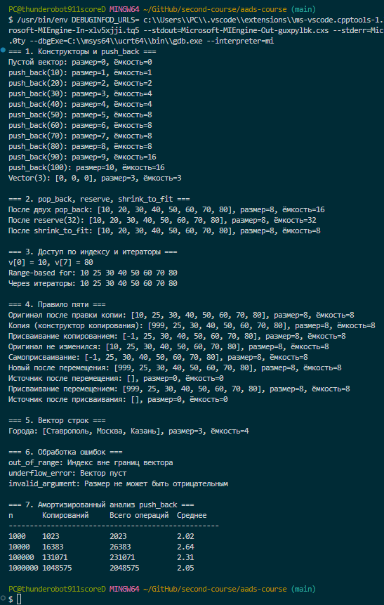

<div align="center">

МИНИСТЕРСТВО НАУКИ И ВЫСШЕГО ОБРАЗОВАНИЯ  
РОССИЙСКОЙ ФЕДЕРАЦИИ

Федеральное государственное автономное образовательное учреждение  
высшего образования

**«СЕВЕРО-КАВКАЗСКИЙ ФЕДЕРАЛЬНЫЙ УНИВЕРСИТЕТ»**

Институт информационных технологий и кибербезопасности  
Кафедра программной инженерии

<br><br><br>

**Отчёт к лабораторной работе № 3**

**Вариант 1**

**Тема:** «Реализация динамического массива, аналога vector. Итераторы»

**Дисциплина:** «Алгоритмы и структуры данных»

</div>

<br><br>

<div align="right">

**Выполнил:**  
Студент группы ПИЖ-б-о-25-1(1),  
направление подготовки: 09.03.04  
«Программная инженерия»  
Абдуллоев Орифжон Олимович

<br>

**Проверила:**  
ассистент кафедры программной инженерии  
Белик Ангелина Игоревна

</div>

<br><br><br>

<div align="center">

Ставрополь  
2026

</div>

---

## Цель работы

Реализовать шаблонный класс `Vector<T>` как аналог `vector` без использования готовых контейнеров. Освоить выделение, расширение и освобождение динамической памяти, закрепить правило трёх и освоить правило пяти. Реализовать итераторы для работы цикла range-based for, а также провести амортизированный анализ операции `push_back`.

## Теоретическая часть

**Динамический массив** хранит элементы в непрерывной области памяти и может менять размер во время работы программы. Память под него выделяется в куче, поэтому ограничена только ресурсами компьютера. В отличие от статического массива он автоматически расширяется при переполнении.

**Размер и ёмкость.** Размер `size` равен числу элементов, которые сейчас хранятся в векторе. Ёмкость `capacity` равна объёму выделенной памяти в элементах. Всегда выполняется условие `size ≤ capacity`.

**Стратегия удвоения.** Когда место заканчивается, выделяется новый массив вдвое большего размера, элементы копируются, старый массив освобождается. Дорогое расширение происходит редко, поэтому вставка в конец имеет амортизированную сложность O(1).

**Правило трёх.** Если классу нужен собственный деструктор, конструктор копирования или оператор присваивания копированием, то почти всегда нужны все три. Это связано с тем, что класс владеет динамической памятью и обязан копировать её глубоко.

**Правило пяти** дополняет правило трёх конструктором перемещения и оператором присваивания перемещением. Они забирают ресурсы временного объекта без копирования данных и оставляют источник в пустом, но корректном состоянии.

**Итератор** — объект, который указывает на элемент контейнера и позволяет перебирать элементы последовательно. Для массива в роли итератора подходит обычный указатель. Достаточно методов `begin` и `end`, чтобы контейнер работал с циклом range-based for и алгоритмами стандартной библиотеки.

**Амортизированный анализ** оценивает среднюю стоимость операции на длинной последовательности операций. Редкие дорогие операции распределяются между многими дешёвыми.

## Постановка задачи

В соответствии с вариантом 1 среднего уровня требуется реализовать шаблонный класс `Vector<T>` со следующими возможностями:

1. конструктор по умолчанию и конструктор с параметром размера;
2. методы `push_back`, `pop_back`, `size`, `capacity`, оператор `[]`;
3. правило пяти: деструктор, конструкторы копирования и перемещения, операторы присваивания копированием и перемещением;
4. методы `reserve` и `shrink_to_fit`;
5. проверка выхода за границы и проверка на самоприсваивание;
6. итераторы `begin` и `end` для работы range-based for;
7. демонстрационная программа и амортизированный анализ `push_back`.

**Ссылка на Git-репозиторий:** 

## Листинг программы

Полный исходный код приведён в отдельном файле `main.cpp`.

```cpp
template <typename T>
class Vector {
private:
    T* data;
    int sz;
    int cap;

public:
    Vector() : data(nullptr), sz(0), cap(0) {}

    explicit Vector(int n) : data(nullptr), sz(0), cap(0) {
        if (n < 0) {
            throw invalid_argument("Размер не может быть отрицательным");
        }
        data = new T[n];
        sz = n;
        cap = n;
        for (int i = 0; i < sz; i++) {
            data[i] = T();
        }
    }

    ~Vector() {
        delete[] data;
    }

    int size() const { return sz; }
    int capacity() const { return cap; }
    bool empty() const { return sz == 0; }
};
```
Листинг 1 — Поля, конструкторы и деструктор

```cpp
    Vector(const Vector& other) : data(nullptr), sz(other.sz), cap(other.sz) {
        data = new T[cap];
        for (int i = 0; i < sz; i++) {
            data[i] = other.data[i];
        }
    }

    Vector(Vector&& other) noexcept : data(other.data), sz(other.sz), cap(other.cap) {
        other.data = nullptr;
        other.sz = 0;
        other.cap = 0;
    }

    Vector& operator=(const Vector& other) {
        if (this != &other) {
            Vector temp(other);
            swap(temp);
        }
        return *this;
    }

    Vector& operator=(Vector&& other) noexcept {
        if (this != &other) {
            delete[] data;
            data = other.data;
            sz = other.sz;
            cap = other.cap;
            other.data = nullptr;
            other.sz = 0;
            other.cap = 0;
        }
        return *this;
    }
```
Листинг 2 — Правило пяти

```cpp
    void reserve(int newCap) {
        if (newCap <= cap) {
            return;
        }
        T* newData = new T[newCap];
        for (int i = 0; i < sz; i++) {
            newData[i] = data[i];
        }
        delete[] data;
        data = newData;
        cap = newCap;
    }

    void shrink_to_fit() {
        if (cap == sz) {
            return;
        }
        if (sz == 0) {
            delete[] data;
            data = nullptr;
            cap = 0;
            return;
        }
        T* newData = new T[sz];
        for (int i = 0; i < sz; i++) {
            newData[i] = data[i];
        }
        delete[] data;
        data = newData;
        cap = sz;
    }

    void push_back(const T& value) {
        if (sz >= cap) {
            reserve(cap == 0 ? 1 : cap * 2);
        }
        data[sz++] = value;
    }

    void pop_back() {
        if (empty()) {
            throw underflow_error("Вектор пуст");
        }
        sz--;
    }
```
Листинг 3 — Управление ёмкостью и изменение размера

```cpp
    T& operator[](int index) {
        if (index < 0 || index >= sz) {
            throw out_of_range("Индекс вне границ вектора");
        }
        return data[index];
    }

    T* begin() { return data; }
    T* end() { return data + sz; }
    const T* begin() const { return data; }
    const T* end() const { return data + sz; }
```
Листинг 4 — Доступ по индексу и итераторы

## Результаты работы

### Конструкторы и рост ёмкости

```
Пустой вектор: размер=0, ёмкость=0
push_back(10): размер=1, ёмкость=1
push_back(20): размер=2, ёмкость=2
push_back(30): размер=3, ёмкость=4
push_back(40): размер=4, ёмкость=4
push_back(50): размер=5, ёмкость=8
push_back(60): размер=6, ёмкость=8
push_back(70): размер=7, ёмкость=8
push_back(80): размер=8, ёмкость=8
push_back(90): размер=9, ёмкость=16
push_back(100): размер=10, ёмкость=16
Vector(3): [0, 0, 0], размер=3, ёмкость=3
```

Ёмкость растёт по степеням двойки: 1, 2, 4, 8, 16. Конструктор с параметром создаёт вектор из нулей.

### reserve и shrink_to_fit

```
После двух pop_back: [10, 20, 30, 40, 50, 60, 70, 80], размер=8, ёмкость=16
После reserve(32): [10, 20, 30, 40, 50, 60, 70, 80], размер=8, ёмкость=32
После shrink_to_fit: [10, 20, 30, 40, 50, 60, 70, 80], размер=8, ёмкость=8
```

Метод `pop_back` уменьшает размер, но не ёмкость. Метод `reserve` увеличивает ёмкость без изменения содержимого, а `shrink_to_fit` возвращает лишнюю память.

### Индексы и итераторы

```
v[0] = 10, v[7] = 80
Range-based for: 10 25 30 40 50 60 70 80
Через итераторы: 10 25 30 40 50 60 70 80
```

### Правило пяти

```
Оригинал после правки копии: [10, 25, 30, 40, 50, 60, 70, 80], размер=8, ёмкость=8
Копия, конструктор копирования: [999, 25, 30, 40, 50, 60, 70, 80], размер=8, ёмкость=8
Присваивание копированием: [-1, 25, 30, 40, 50, 60, 70, 80], размер=8, ёмкость=8
Оригинал не изменился: [10, 25, 30, 40, 50, 60, 70, 80], размер=8, ёмкость=8
Самоприсваивание: [-1, 25, 30, 40, 50, 60, 70, 80], размер=8, ёмкость=8
Новый после перемещения: [999, 25, 30, 40, 50, 60, 70, 80], размер=8, ёмкость=8
Источник после перемещения: [], размер=0, ёмкость=0
Присваивание перемещением: [999, 25, 30, 40, 50, 60, 70, 80], размер=8, ёмкость=8
Источник после присваивания: [], размер=0, ёмкость=0
```

Изменение копии не затрагивает оригинал, значит копирование глубокое. Самоприсваивание не портит данные. После перемещения источник пуст, а данные принадлежат новому объекту.

### Вектор строк

```
Города: [Ставрополь, Москва, Казань], размер=3, ёмкость=4
```

### Обработка ошибок

```
out_of_range: Индекс вне границ вектора
underflow_error: Вектор пуст
invalid_argument: Размер не может быть отрицательным
```

### Амортизированный анализ push_back

Копирования считались в момент расширения: если ёмкость изменилась, к счётчику прибавляется размер вектора до вставки.

| n | Копирований | Всего операций | Среднее на вставку |
|---|---|---|---|
| 1 000 | 1 023 | 2 023 | 2,02 |
| 10 000 | 16 383 | 26 383 | 2,64 |
| 100 000 | 131 071 | 231 071 | 2,31 |
| 1 000 000 | 1 048 575 | 2 048 575 | 2,05 |

При росте `n` в 1000 раз среднее число операций на одну вставку остаётся в пределах от 2 до 3 и не растёт. Это подтверждает амортизированную сложность O(1).



## Анализ сложности

| Операция | Сложность | Обоснование |
|---|---|---|
| Конструктор по умолчанию | O(1) | Присваивание трёх полей |
| Конструктор с размером n | O(n) | Выделение и заполнение n элементов |
| Конструктор копирования | O(n) | Копирование n элементов |
| Конструктор перемещения | O(1) | Передача указателя без копирования данных |
| Присваивание копированием | O(n) | Копия временного объекта и обмен |
| Присваивание перемещением | O(1) | Передача указателя |
| Деструктор | O(1) для int, иначе O(n) | Для простых типов освобождение не зависит от размера, для классов вызываются деструкторы элементов |
| `operator[]` | O(1) | Прямое обращение по индексу |
| `size`, `capacity`, `empty` | O(1) | Возврат поля |
| `push_back` | O(1) амортизированно, O(n) в худшем случае | Расширение с копированием происходит редко |
| `pop_back` | O(1) | Уменьшение размера на единицу |
| `reserve` | O(n) | Копирование n элементов в новый массив |
| `shrink_to_fit` | O(n) | Копирование n элементов в массив точного размера |
| `swap` | O(1) | Обмен тремя полями |
| `begin`, `end` | O(1) | Возврат указателя |

Пространственная сложность хранения равна O(n). Расширение временно требует O(n) дополнительной памяти.

## Ответы на контрольные вопросы

**1. Почему динамический массив называется «динамическим»?**

Его размер определяется и меняется во время выполнения программы. Память выделяется в куче по мере необходимости, а не фиксируется на этапе компиляции.

**2. Что такое ёмкость и чем она отличается от размера?**

Размер — это количество хранимых элементов, ёмкость — количество элементов, для которых уже выделена память. Ёмкость всегда не меньше размера. Разница между ними позволяет добавлять элементы без нового выделения памяти.

**3. Почему при расширении ёмкость удваивается, а не увеличивается на фиксированное число?**

При увеличении на фиксированную величину `k` расширений будет порядка n/k, и каждое копирует до n элементов, поэтому общая стоимость растёт как n². При удвоении расширений всего log n, а суммарное число копирований не превышает 2n. Поэтому средняя стоимость вставки остаётся константной.

**4. Какова амортизированная сложность `push_back`? Почему?**

O(1). Расширения происходят при размерах 1, 2, 4, 8 и так далее, и суммарное число копирований равно 1 + 2 + 4 + … + 2^k, то есть меньше 2n. Вместе с n самими вставками получается меньше 3n операций на n вставок, то есть не более трёх операций на вставку. Это подтверждено таблицей в разделе результатов.

**5. Что такое «правило трёх»? Когда оно применяется?**

Если классу нужен собственный деструктор, конструктор копирования или оператор присваивания копированием, то нужны все три. Правило применяется к классам, которые владеют ресурсами, например динамической памятью. Без него копии разделяют один указатель, а при уничтожении память освобождается дважды.

**6. Что такое «правило пяти»? Чем оно отличается от «правила трёх»?**

Правило пяти добавляет к трём методам конструктор перемещения и оператор присваивания перемещением. Они нужны, чтобы временные объекты передавали ресурсы без копирования. Если их не определить, при наличии пользовательских методов копирования перемещение заменится копированием, а это медленнее.

**7. В чём разница между конструктором копирования и оператором присваивания?**

Конструктор копирования создаёт новый объект на основе существующего, а оператор присваивания работает с уже существующим объектом. Поэтому оператору присваивания нужно сначала освободить или заменить старые данные и проверить самоприсваивание. Конструктору этого делать не нужно.

**8. Зачем нужна проверка `if (this != &other)` в операторе присваивания?**

Она защищает от самоприсваивания вида `a = a`. В реализации с освобождением старой памяти без этой проверки объект удалил бы собственные данные, а затем копировал бы из уже освобождённой памяти.

**9. Что такое итератор? Как он связан с указателем?**

Итератор — объект, указывающий на элемент контейнера и позволяющий перебирать элементы по порядку. Для динамического массива элементы лежат подряд, поэтому роль итератора выполняет обычный указатель. Операции `*it`, `++it`, `it + 2` и сравнение работают так же, как для указателей.

**10. Зачем нужны методы `begin` и `end`?**

Метод `begin` возвращает итератор на первый элемент, а `end` — на позицию сразу после последнего. Вместе они задают полуинтервал, который можно перебирать циклом и передавать в алгоритмы, например в `sort`.

**11. Как реализовать range-based for для своего контейнера?**

Достаточно определить методы `begin` и `end`, возвращающие итераторы. Тогда компилятор развернёт `for (int x : v)` в обычный цикл по итераторам. Для константных объектов нужны также константные версии этих методов.

**12. Что такое «глубокое копирование»? Чем оно отличается от «поверхностного»?**

При глубоком копировании выделяется новая память и в неё копируются сами данные, поэтому копия независима от оригинала. При поверхностном копируется только значение указателя, и два объекта указывают на одну и ту же память. Тогда изменение одного влияет на другой, а деструкторы освобождают память дважды. В работе это проверено: правка копии не изменила оригинал.

**13. Что такое семантика перемещения и зачем она нужна?**

Это передача ресурсов от одного объекта другому без копирования данных. Источник остаётся в корректном, но пустом состоянии. Для вектора перемещение сводится к копированию трёх полей и занимает O(1) вместо O(n). Это особенно важно при возврате объектов из функций и работе с временными значениями.

**14. Почему конструктор перемещения помечается `noexcept`?**

Перемещение не выделяет память и не может бросить исключение. Пометка `noexcept` позволяет стандартным контейнерам, например `vector`, при расширении использовать перемещение вместо копирования. Без неё они выбирают копирование, чтобы сохранить строгую гарантию безопасности исключений.

**15. Как правильно освобождать память в деструкторе?**

Память, выделенную через `new[]`, освобождают через `delete[]`. Применять `delete` без скобок к массиву нельзя. Освобождение `nullptr` безопасно, поэтому отдельная проверка не нужна. После перемещения источник получает `nullptr`, и его деструктор ничего не удалит.

## Вывод

В ходе лабораторной работы реализован шаблонный класс `Vector<T>`, работающий как аналог `vector`. Освоено управление динамической памятью: выделение, расширение удвоением и освобождение. Реализованы правило трёх и правило пяти, причём корректность глубокого копирования, самоприсваивания и перемещения проверена в демонстрационной программе. Добавлены итераторы в виде указателей, благодаря которым контейнер работает с range-based for. Программа проверена с санитайзерами памяти и не имеет утечек. Амортизированный анализ подтвердил, что `push_back` выполняется за O(1) в среднем: на одну вставку приходится от 2 до 3 операций независимо от размера вектора.
