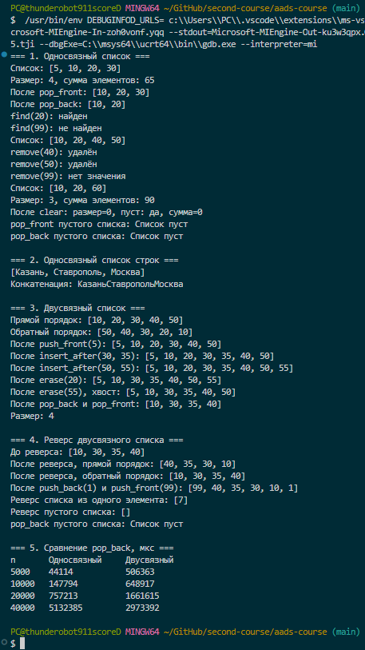

<div align="center">

МИНИСТЕРСТВО НАУКИ И ВЫСШЕГО ОБРАЗОВАНИЯ  
РОССИЙСКОЙ ФЕДЕРАЦИИ

Федеральное государственное автономное образовательное учреждение  
высшего образования

**«СЕВЕРО-КАВКАЗСКИЙ ФЕДЕРАЛЬНЫЙ УНИВЕРСИТЕТ»**

Институт информационных технологий и кибербезопасности  
Кафедра программной инженерии

<br><br><br>

**Отчёт к лабораторной работе № 4**

**Вариант 1**

**Тема:** «Односвязный и двусвязный списки»

**Дисциплина:** «Алгоритмы и структуры данных»

</div>

<br><br>

<div align="right">

**Выполнил:**  
Студент группы ПИЖ-б-о-25-1(1),  
направление подготовки: 09.03.04  
«Программная инженерия»  
Абдуллоев Орифжон Олимович

<br>

**Проверила:**  
ассистент кафедры программной инженерии  
Белик Ангелина Игоревна

</div>

<br><br><br>

<div align="center">

Ставрополь  
2026

</div>

---

## Цель работы

Реализовать шаблонные классы односвязного и двусвязного списков с базовыми операциями вставки, удаления, поиска и обхода. Освоить корректное управление памятью при работе с узлами, сравнить особенности и производительность двух видов списков и реализовать разворот двусвязного списка.

## Теоретическая часть

**Связный список** — структура данных, в которой элементы, называемые узлами, не лежат в памяти подряд. Каждый узел хранит данные и указатель на следующий узел, а в двусвязном списке ещё и на предыдущий.

**Узел** односвязного списка содержит значение и указатель `next`. Узел двусвязного списка дополнительно содержит указатель `prev`.

**Голова** `head` — указатель на первый узел списка. **Хвост** `tail` — указатель на последний узел. Хранение хвоста позволяет добавлять элемент в конец за O(1) вместо прохода по всему списку. Конец списка обозначается значением `nullptr`.

**Односвязный список** позволяет двигаться только вперёд. **Двусвязный список** позволяет двигаться в обе стороны, поэтому в нём можно удалить последний узел или произвольный узел за O(1), не разыскивая предыдущий.

Сравнение с динамическим массивом:

| Операция | Динамический массив | Односвязный список | Двусвязный список |
|---|---|---|---|
| Доступ по индексу | O(1) | O(n) | O(n) |
| Вставка в начало | O(n) | O(1) | O(1) |
| Вставка в конец | O(1) амортизированно | O(1) с tail | O(1) с tail |
| Удаление из начала | O(n) | O(1) | O(1) |
| Удаление из конца | O(1) | O(n) | O(1) |
| Поиск по значению | O(n) | O(n) | O(n) |
| Память на элемент | Данные | Данные и один указатель | Данные и два указателя |

**Управление памятью.** Каждый узел создаётся через `new`, поэтому его необходимо удалять через `delete`. Деструктор списка должен пройти по всем узлам и удалить каждый, иначе возникает утечка памяти.

## Постановка задачи

В соответствии с вариантом 1 требуется:

1. базовый уровень: реализовать односвязный список с методами `push_front`, `pop_front`, `print`, а также найти сумму всех элементов;
2. средний уровень: реализовать двусвязный список с базовыми операциями и корректной работой с `tail`, а также метод `reverse` для разворота списка;
3. обработать операции над пустым списком;
4. показать работу всех методов в демонстрационной программе;
5. сравнить время удаления из конца в двух списках.

**Ссылка на Git-репозиторий:** 

https://github.com/Abdulloevo7/aads-course/blob/main/lab4/PW-4-aads.md

## Листинг программы

Полный исходный код приведён в отдельном файле `main.cpp`.

```cpp
template <typename T>
struct Node {
    T data;
    Node<T>* next;

    Node(const T& value) : data(value), next(nullptr) {}
};

template <typename T>
struct DNode {
    T data;
    DNode<T>* prev;
    DNode<T>* next;

    DNode(const T& value) : data(value), prev(nullptr), next(nullptr) {}
};
```
Листинг 1 — Узлы списков

```cpp
template <typename T>
class SinglyLinkedList {
private:
    Node<T>* head;
    Node<T>* tail;
    int count;

public:
    SinglyLinkedList() : head(nullptr), tail(nullptr), count(0) {}

    SinglyLinkedList(const SinglyLinkedList&) = delete;
    SinglyLinkedList& operator=(const SinglyLinkedList&) = delete;

    ~SinglyLinkedList() {
        clear();
    }

    void push_front(const T& value) {
        Node<T>* newNode = new Node<T>(value);
        newNode->next = head;
        head = newNode;
        if (tail == nullptr) {
            tail = newNode;
        }
        count++;
    }

    void push_back(const T& value) {
        Node<T>* newNode = new Node<T>(value);
        if (head == nullptr) {
            head = tail = newNode;
        } else {
            tail->next = newNode;
            tail = newNode;
        }
        count++;
    }

    void pop_front() {
        if (head == nullptr) {
            throw underflow_error("Список пуст");
        }
        Node<T>* temp = head;
        head = head->next;
        delete temp;
        count--;
        if (head == nullptr) {
            tail = nullptr;
        }
    }
```
Листинг 2 — Односвязный список, вставка в начало и в конец, удаление из начала

```cpp
    void pop_back() {
        if (head == nullptr) {
            throw underflow_error("Список пуст");
        }
        if (head->next == nullptr) {
            delete head;
            head = tail = nullptr;
        } else {
            Node<T>* current = head;
            while (current->next != tail) {
                current = current->next;
            }
            delete tail;
            tail = current;
            tail->next = nullptr;
        }
        count--;
    }

    bool remove(const T& value) {
        if (head == nullptr) {
            return false;
        }
        if (head->data == value) {
            pop_front();
            return true;
        }
        Node<T>* current = head;
        while (current->next != nullptr && current->next->data != value) {
            current = current->next;
        }
        if (current->next == nullptr) {
            return false;
        }
        Node<T>* toDelete = current->next;
        current->next = toDelete->next;
        if (toDelete == tail) {
            tail = current;
        }
        delete toDelete;
        count--;
        return true;
    }

    T sum() const {
        T total = T();
        for (Node<T>* current = head; current != nullptr; current = current->next) {
            total = total + current->data;
        }
        return total;
    }
```
Листинг 3 — Односвязный список, удаление и сумма элементов

```cpp
    void erase(DNode<T>* node) {
        if (node == nullptr) {
            return;
        }
        if (node == head) {
            pop_front();
            return;
        }
        if (node == tail) {
            pop_back();
            return;
        }
        node->prev->next = node->next;
        node->next->prev = node->prev;
        delete node;
        count--;
    }

    void insert_after(DNode<T>* node, const T& value) {
        if (node == nullptr) {
            push_front(value);
            return;
        }
        DNode<T>* newNode = new DNode<T>(value);
        newNode->next = node->next;
        newNode->prev = node;
        if (node->next != nullptr) {
            node->next->prev = newNode;
        } else {
            tail = newNode;
        }
        node->next = newNode;
        count++;
    }
```
Листинг 4 — Двусвязный список, вставка и удаление по узлу

```cpp
    void reverse() {
        DNode<T>* current = head;
        while (current != nullptr) {
            DNode<T>* temp = current->prev;
            current->prev = current->next;
            current->next = temp;
            current = current->prev;
        }
        DNode<T>* tmp = head;
        head = tail;
        tail = tmp;
    }
```
Листинг 5 — Двусвязный список, разворот

## Результаты работы

### Односвязный список

```
Список: [5, 10, 20, 30]
Размер: 4, сумма элементов: 65
После pop_front: [10, 20, 30]
После pop_back: [10, 20]
find(20): найден
find(99): не найден
Список: [10, 20, 40, 50]
remove(40): удалён
remove(50): удалён
remove(99): нет значения
Список: [10, 20, 60]
Размер: 3, сумма элементов: 90
После clear: размер=0, пуст: да, сумма=0
pop_front пустого списка: Список пуст
pop_back пустого списка: Список пуст
```

Удаление хвостового элемента командой `remove(50)` корректно сдвинуло `tail`: следующая вставка `push_back(60)` добавила элемент в конец, а не потеряла его. Операции над пустым списком выбрасывают исключение вместо обращения к нулевому указателю.

### Список строк

```
[Казань, Ставрополь, Москва]
Конкатенация: КазаньСтавропольМосква
```

Шаблон работает не только с числами, метод `sum` для строк выполняет конкатенацию.

### Двусвязный список

```
Прямой порядок: [10, 20, 30, 40, 50]
Обратный порядок: [50, 40, 30, 20, 10]
После push_front(5): [5, 10, 20, 30, 40, 50]
После insert_after(30, 35): [5, 10, 20, 30, 35, 40, 50]
После insert_after(50, 55): [5, 10, 20, 30, 35, 40, 50, 55]
После erase(20): [5, 10, 30, 35, 40, 50, 55]
После erase(55), хвост: [5, 10, 30, 35, 40, 50]
После pop_back и pop_front: [10, 30, 35, 40]
Размер: 4
```

Обход в обратном порядке даёт зеркальный результат, значит указатели `prev` расставлены верно. Вставка после последнего узла и удаление хвостового узла проверены отдельно, `tail` обновляется правильно.

### Реверс двусвязного списка

```
До реверса: [10, 30, 35, 40]
После реверса, прямой порядок: [40, 35, 30, 10]
После реверса, обратный порядок: [10, 30, 35, 40]
После push_back(1) и push_front(99): [99, 40, 35, 30, 10, 1]
Реверс списка из одного элемента: [7]
Реверс пустого списка: []
pop_back пустого списка: Список пуст
```

После разворота прямой и обратный обходы поменялись местами. Последующие `push_back` и `push_front` работают корректно, то есть `head` и `tail` обменены правильно. Граничные случаи, пустой список и список из одного элемента, обработаны.

### Сравнение удаления из конца

Из списка размером `n` последовательно удалялись все элементы командой `pop_back`:

| n | Односвязный, мкс | Двусвязный, мкс |
|---|---|---|
| 5 000 | 56 317 | 139 |
| 10 000 | 204 363 | 211 |
| 20 000 | 952 995 | 376 |
| 40 000 | 6 095 624 | 1 454 |

Время односвязного списка растёт примерно квадратично: при удвоении `n` оно увеличивается в 4–6 раз, потому что каждый `pop_back` проходит весь список. Время двусвязного списка растёт примерно линейно, так как каждое удаление занимает O(1). Разница на 40 000 элементов составляет более трёх порядков.



## Анализ сложности

### Односвязный список

| Операция | Сложность | Обоснование |
|---|---|---|
| `push_front` | O(1) | Смена указателя головы |
| `push_back` | O(1) | Доступ к хвосту через tail |
| `pop_front` | O(1) | Смена указателя головы |
| `pop_back` | O(n) | Нужно дойти до предпоследнего узла |
| `find` | O(n) | Последовательный обход |
| `remove` | O(n) | Поиск узла, затем удаление за O(1) |
| `sum` | O(n) | Один проход по списку |
| `print` | O(n) | Один проход по списку |
| `clear`, деструктор | O(n) | Удаление каждого узла |
| `size`, `empty` | O(1) | Возврат поля |

### Двусвязный список

| Операция | Сложность | Обоснование |
|---|---|---|
| `push_front`, `push_back` | O(1) | Доступ к головному и хвостовому узлам |
| `pop_front`, `pop_back` | O(1) | Предыдущий узел доступен через prev |
| `find` | O(n) | Последовательный обход |
| `insert_after` | O(1) | Узел уже известен, меняются четыре указателя |
| `erase` | O(1) | Узел известен, соседи доступны через prev и next |
| `reverse` | O(n) | Один проход с обменом указателей |
| `print`, `printReverse` | O(n) | Один проход по списку |
| `clear`, деструктор | O(n) | Удаление каждого узла |
| `size`, `empty` | O(1) | Возврат поля |

Пространственная сложность обоих списков равна O(n). Метод `reverse` использует O(1) дополнительной памяти.

## Ответы на контрольные вопросы

**1. Чем связный список отличается от динамического массива?**

Элементы массива лежат в памяти подряд, а узлы списка разбросаны и связаны указателями. Поэтому массив даёт доступ по индексу за O(1), но вставка в начало стоит O(n). У списка наоборот: вставка и удаление в начале занимают O(1), а доступ по индексу требует прохода от головы. Список тратит больше памяти на элемент из-за указателей.

**2. Какие операции в односвязном списке выполняются за O(1)?**

Вставка в начало, вставка в конец при наличии указателя `tail`, удаление из начала, а также `size` и `empty`. Вставка после уже известного узла тоже занимает O(1).

**3. Почему удаление из конца односвязного списка требует O(n) времени?**

После удаления последнего узла `tail` должен указывать на предпоследний, а `next` предпоследнего нужно обнулить. Узел не хранит ссылку назад, поэтому предпоследний можно найти только проходом от головы. Эксперимент это подтверждает: на 40 000 элементов удаление заняло более шести секунд.

**4. Какие преимущества даёт хранение указателя `tail` в односвязном списке?**

Он позволяет добавлять элемент в конец за O(1) вместо O(n). Без него пришлось бы каждый раз проходить весь список. Цена этого удобства: `tail` нужно поддерживать при каждом удалении и очистке.

**5. Чем двусвязный список отличается от односвязного?**

Каждый узел двусвязного списка хранит два указателя, на следующий и на предыдущий узлы. Это позволяет обходить список в обе стороны и удалять узлы без поиска предшественника. Платой становится дополнительный указатель в каждом узле и более сложные операции вставки и удаления.

**6. Какие операции в двусвязном списке выполняются быстрее, чем в односвязном?**

Удаление из конца: O(1) против O(n). Удаление произвольного узла по указателю: O(1) против O(n), так как не нужно искать предыдущий узел. Вставка перед заданным узлом и обход в обратном порядке тоже становятся простыми.

**7. Что такое «голова» и «хвост» списка?**

Голова `head` — указатель на первый узел, хвост `tail` — указатель на последний. Через голову начинается любой обход. Хвост нужен для быстрой вставки в конец. У пустого списка оба указателя равны `nullptr`.

**8. Как удалить узел из середины односвязного списка?**

Нужно найти предыдущий узел, переставить его `next` на узел после удаляемого и вызвать `delete` для удаляемого узла. В работе так устроен метод `remove`. Если удаляется последний узел, надо обновить `tail`.

**9. Как удалить узел из середины двусвязного списка? Почему это проще?**

Достаточно связать соседей между собой, то есть `node->prev->next = node->next` и `node->next->prev = node->prev`, а затем удалить узел. Это проще, потому что предыдущий узел доступен через `prev` и поиск от головы не нужен. Операция выполняется за O(1) при известном указателе на узел.

**10. Что произойдёт, если забыть обновить `tail` при удалении?**

Указатель `tail` останется на удалённый узел, то есть станет висячим. Следующий `push_back` запишет данные в освобождённую память, что приведёт к неопределённому поведению, потере элементов или аварийному завершению. Поэтому в `pop_front`, `pop_back` и `remove` хвост обновляется отдельно.

**11. Как реализовать реверс односвязного списка?**

Нужно пройти по списку тремя указателями: предыдущий, текущий и следующий. На каждом шаге развернуть `next` текущего узла в сторону предыдущего. Так выполняется один проход за O(n) и дополнительная память O(1). В конце голова и хвост меняются местами. В двусвязном списке реверс устроен проще: у каждого узла меняются местами `prev` и `next`, как в методе `reverse` этой работы.

**12. Как обнаружить цикл в связном списке?**

Алгоритмом Флойда с двумя указателями. Медленный указатель двигается на один узел за шаг, быстрый на два. Если в списке есть цикл, быстрый указатель рано или поздно догонит медленный. Если быстрый достиг `nullptr`, цикла нет. Сложность O(n) по времени и O(1) по памяти.

**13. В каких случаях стоит использовать список вместо массива?**

Когда часто выполняются вставки и удаления в начале или в середине при известном положении, а доступ по индексу нужен редко. Также когда размер сильно меняется, а перенос больших объёмов элементов при расширении нежелателен. Если нужен быстрый доступ по индексу или важна скорость обхода благодаря кэшу, лучше массив.

**14. Какая дополнительная память требуется для каждого узла списка?**

В односвязном списке один указатель на узел, на 64-битной системе это 8 байт. В двусвязном списке два указателя, то есть 16 байт. К этому добавляются накладные расходы аллокатора на каждый отдельный `new`.

**15. Почему доступ по индексу в списке имеет сложность O(n)?**

Узлы не лежат подряд, поэтому адрес элемента с номером `i` нельзя вычислить по формуле. Чтобы добраться до него, нужно последовательно пройти `i` узлов от головы, а в худшем случае пройти весь список.

## Вывод

В ходе лабораторной работы реализованы шаблонные классы односвязного и двусвязного списков с вставкой, удалением, поиском, обходом и корректной работой с указателями `head` и `tail`. Для односвязного списка реализован подсчёт суммы элементов, для двусвязного списка реализован разворот. Управление памятью проверено инструментами контроля памяти, утечек и ошибок доступа не обнаружено. Для защиты от двойного освобождения копирование списков запрещено. Операции над пустым списком обрабатываются исключением. Эксперимент показал, что удаление из конца в односвязном списке растёт квадратично из-за прохода по узлам, а в двусвязном выполняется за константное время. Это подтвердило теоретические оценки сложности.
